I build software that runs close to the machine: native desktop apps, on-device AI, browser engines and network automation. 
I care about what happens under the hood as much as what the user sees.

## 🪐 Tech Universe

## 🛰️ Arsenal

<table align="center">
<tr>
<td align="right" width="190"><b>Languages</b></td>
<td>

</td>
</tr>
<tr>
<td align="right"><b>Frontend</b></td>
<td>

</td>
</tr>
<tr>
<td align="right"><b>Backend &amp; APIs</b></td>
<td>

</td>
</tr>
<tr>
<td align="right"><b>Desktop &amp; Native</b></td>
<td>

</td>
</tr>
<tr>
<td align="right"><b>AI &amp; ML</b></td>
<td>

</td>
</tr>
<tr>
<td align="right"><b>Scientific Computing</b></td>
<td>

</td>
</tr>
<tr>
<td align="right"><b>Databases</b></td>
<td>

</td>
</tr>
<tr>
<td align="right"><b>Networking</b></td>
<td>

</td>
</tr>
<tr>
<td align="right"><b>Testing</b></td>
<td>

</td>
</tr>
<tr>
<td align="right"><b>Tooling</b></td>
<td>

</td>
</tr>
</table>

## 🌌 Design &amp; Analysis

<table>
<tr>
<td width="33%" valign="top">

#### ⚙️ Algorithms
- Asymptotic time and space analysis
- Divide and conquer: merge sort, quick sort, binary search
- Greedy and dynamic programming: knapsack
- Graph traversal: BFS, DFS
- Heaps, hashing, monotonic stacks, two pointers

</td>
<td width="33%" valign="top">

#### 🏗️ Systems
- Local-first, privacy-by-default architecture
- Gateway and proxy design: REST + MCP over one engine
- Threaded engine loops and incremental, time-sliced pipelines
- Retrieval-augmented generation with grounded answers
- Network segmentation: flat to micro-segmented designs

</td>
<td width="33%" valign="top">

#### 📐 Data &amp; Math
- Relational design: normal forms, indexes, views, triggers, stored procedures
- Fourier transforms, SVD and Wiener filtering
- Perceptual colour spaces (OKLab)
- Real-time face landmarks and gaze estimation
- Safe UX: confirmations and undo for every risky action

</td>
</tr>
</table>

## 🚀 Mission Log

| 🛰️ In orbit (learning now) | 🚀 Next launch | 🌠 Deep space |
| :--- | :--- | :--- |
| DSA in C++ on LeetCode | Next.js | Advanced DP and graph algorithms |
| FastAPI | PostgreSQL · MongoDB | C++ internals: memory, move semantics, low latency |
| TypeScript + Express | Docker · Redis | Deep learning with PyTorch and TensorFlow |
| Linux and Bash | Supabase · Firebase | System design |
| OS · DBMS · Computer Networks | React Native · Flutter | Open-source contribution (GSoC) |
| Cyber security and CTFs | scikit-learn | |

## 📡 Telemetry

 

