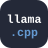

<h1 align="center">Rohith AD</h1>

I build software that runs close to the machine: native desktop apps, on-device AI, browser engines and network automation. 
I care about what happens under the hood as much as what the user sees.

## Tech Universe

<picture>
  <source media="(prefers-color-scheme: light)" srcset="./assets/orbit-light.svg" />
  <source media="(prefers-color-scheme: dark)" srcset="./assets/orbit.svg" />
  
</picture>

## Arsenal

<table align="center">
<tr>
<td align="right" width="190"><b>Languages</b></td>
<td>

</td>
</tr>
<tr>
<td align="right"><b>Frontend</b></td>
<td>

</td>
</tr>
<tr>
<td align="right"><b>Backend &amp; APIs</b></td>
<td>

</td>
</tr>
<tr>
<td align="right"><b>Desktop &amp; Native</b></td>
<td>

</td>
</tr>
<tr>
<td align="right"><b>AI &amp; ML</b></td>
<td>

</td>
</tr>
<tr>
<td align="right"><b>Scientific Computing</b></td>
<td>

</td>
</tr>
<tr>
<td align="right"><b>Databases</b></td>
<td>

</td>
</tr>
<tr>
<td align="right"><b>Networking</b></td>
<td>

</td>
</tr>
<tr>
<td align="right"><b>Testing</b></td>
<td>

</td>
</tr>
<tr>
<td align="right"><b>Tooling</b></td>
<td>

</td>
</tr>
</table>

## Design &amp; Analysis

<table>
<tr>
<td width="33%" valign="top">

#### Algorithms
- Asymptotic time and space analysis
- Divide and conquer: merge sort, quick sort, binary search
- Greedy and dynamic programming: knapsack
- Graph traversal: BFS, DFS
- Heaps, hashing, monotonic stacks, two pointers

</td>
<td width="33%" valign="top">

#### Systems
- Local-first, privacy-by-default architecture
- Gateway and proxy design: REST + MCP over one engine
- Threaded engine loops and incremental, time-sliced pipelines
- Retrieval-augmented generation with grounded answers
- Network segmentation: flat to micro-segmented designs

</td>
<td width="33%" valign="top">

#### Data &amp; Math
- Relational design: normal forms, indexes, views, triggers, stored procedures
- Fourier transforms, SVD and Wiener filtering
- Perceptual colour spaces (OKLab)
- Real-time face landmarks and gaze estimation
- Safe UX: confirmations and undo for every risky action

</td>
</tr>
</table>

## Mission Log

| In orbit (learning now) | Next launch | Deep space |
| :--- | :--- | :--- |
| DSA in C++ on LeetCode | Next.js | Advanced DP and graph algorithms |
| FastAPI | PostgreSQL · MongoDB | C++ internals: memory, move semantics, low latency |
| TypeScript + Express | Docker · Redis | Deep learning with PyTorch and TensorFlow |
| Linux and Bash | Supabase · Firebase | System design |
| OS · DBMS · Computer Networks | React Native · Flutter | Open-source contribution (GSoC) |
| Cyber security and CTFs | scikit-learn | |

## Telemetry

<picture>
  <source media="(prefers-color-scheme: light)" srcset="https://github-profile-summary-cards.vercel.app/api/cards/profile-details?username=Rohithadzero&theme=github" />
  <source media="(prefers-color-scheme: dark)" srcset="https://github-profile-summary-cards.vercel.app/api/cards/profile-details?username=Rohithadzero&theme=github_dark" />
  
</picture>

<picture>
  <source media="(prefers-color-scheme: light)" srcset="https://streak-stats.demolab.com?user=Rohithadzero&background=FFFFFF&ring=0969DA&fire=0969DA&currStreakLabel=1F2328&sideLabels=1F2328&currStreakNum=1F2328&sideNums=1F2328&dates=656D76&stroke=D0D7DE&hide_border=true" />
  <source media="(prefers-color-scheme: dark)" srcset="https://streak-stats.demolab.com?user=Rohithadzero&background=0D1117&ring=58A6FF&fire=58A6FF&currStreakLabel=E6EDF3&sideLabels=E6EDF3&currStreakNum=E6EDF3&sideNums=E6EDF3&dates=8B949E&stroke=30363D&hide_border=true" />
  
</picture>

 

<i>Per aspera ad astra: through hardships to the stars.</i>

