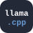

<picture>
  <source media="(prefers-color-scheme: light)" srcset="./assets/header-light.svg" />
  <source media="(prefers-color-scheme: dark)" srcset="./assets/header.svg" />
  
</picture>

I build local-first desktop apps, on-device AI tools and network automation.

<table align="center">
<tr>
<td align="right"><b>Languages</b></td>
<td>

</td>
</tr>
<tr>
<td align="right"><b>Web</b></td>
<td>

</td>
</tr>
<tr>
<td align="right"><b>Desktop</b></td>
<td>

</td>
</tr>
<tr>
<td align="right"><b>AI &amp; Data</b></td>
<td>

</td>
</tr>
<tr>
<td align="right"><b>Data &amp; Tools</b></td>
<td>

</td>
</tr>
</table>

<i>Per aspera ad astra: through hardships to the stars.</i>

